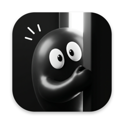
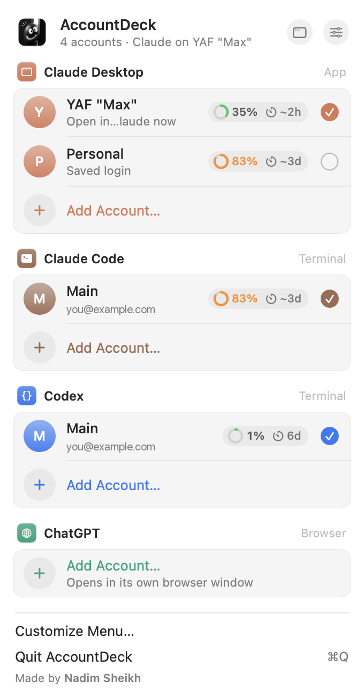
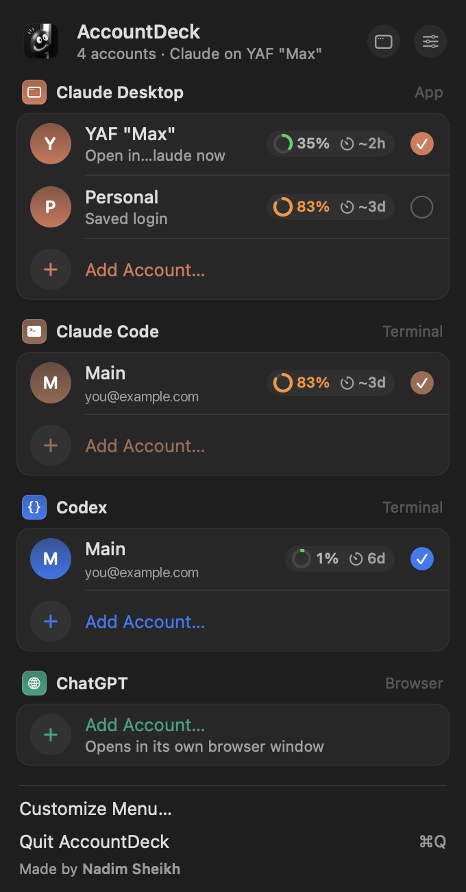

<p align="center">
  
</p>

<h1 align="center">AccountDeck</h1>

<p align="center">
  <b>One menu bar app for all your Claude, Claude Code, Codex and ChatGPT accounts.</b><br>
  Switch accounts in one click, see how much of each limit you've used, and keep your chats with you.
</p>

<p align="center">
  <a href="https://github.com/nadim-sheikh/AccountDeck/releases/latest"></a>
  
  
  <a href="LICENSE"></a>
</p>

<p align="center">
  
  &nbsp;&nbsp;
  
</p>

---

## Download

| Platform | File | Notes |
|---|---|---|
| **macOS** 14 or later (Apple silicon and Intel) | [`AccountDeck-1.3.dmg`](https://github.com/nadim-sheikh/AccountDeck/releases/latest) | Stable |
| **Windows** 10/11 (works on every PC) | [`AccountDeck-Setup-1.0.0.exe`](https://github.com/nadim-sheikh/AccountDeck/releases/latest) | **Beta**, not yet tested on a real Windows PC |
| Windows, Intel/AMD only (smaller) | [`AccountDeck-Setup-1.0.0-x64.exe`](https://github.com/nadim-sheikh/AccountDeck/releases/latest) | Beta |
| Windows on Arm only (smaller) | [`AccountDeck-Setup-1.0.0-arm64.exe`](https://github.com/nadim-sheikh/AccountDeck/releases/latest) | Beta |

All files are on the [Releases page](https://github.com/nadim-sheikh/AccountDeck/releases/latest).

## Install on a Mac

1. Open `AccountDeck-1.3.dmg` and drag **AccountDeck** onto **Applications**.
2. Open AccountDeck from Applications. macOS says it can't check the app for malicious software, because it isn't from the App Store or a registered Apple developer. Click **Done** (not *Move to Trash*).
3. Open **System Settings → Privacy & Security**, scroll down, and click **Open Anyway** next to AccountDeck. Confirm with your password or Touch ID.
4. AccountDeck opens, and its mascot appears in the menu bar. You only have to do this once.

Updating? Quit AccountDeck, drag the new version over the old one, and open it again. Your accounts stay where they are.

## Install on Windows (beta)

1. Download the installer and double-click it.
2. **Windows SmartScreen will warn you**, because the app isn't signed with a paid certificate. Click **More info**, then **Run anyway**.
3. AccountDeck opens its Dashboard and puts a small face icon in the tray next to the clock.

The Windows version was built and tested against a simulated Windows profile, but hasn't run on a real PC yet. See [windows/README.md](windows/README.md) for what still needs checking. Bug reports are very welcome.

---

## What it does

| App | How switching works |
|---|---|
| **Claude Desktop** | Closes Claude, saves the current login, puts the chosen account's login back and reopens Claude. Your Code-tab chats follow you to every account. |
| **Claude Code** | Each account gets its own config folder (`CLAUDE_CONFIG_DIR`). New terminal windows use the active account. |
| **Codex** | The same, with `CODEX_HOME`. |
| **ChatGPT** | Each account opens in its own browser profile, so you stay signed in to all of them. |

**Usage limits, live.** Each account shows how much of its 5-hour and weekly limit you've used and when it resets. AccountDeck watches the files these readings come from, so new numbers show up within about a second.
- Claude Code reports its limits with every reply, through a small status-line hook that AccountDeck can add for you. The hook prints nothing, and AccountDeck never replaces a status line you already have.
- Codex limits come from its session logs.
- Claude Desktop limits come from its own usage history. That history has no reset time, so the reset shown is an estimate (marked `~`).

**Chats follow you (Claude Desktop).** Each time you switch accounts, the account you switch to gets your new chats from the other accounts, plus the latest version of every chat you changed. Chats you deleted elsewhere are removed there too. Before the first sync AccountDeck backs up all your chat lists, and it keeps a copy of anything it replaces or removes. You can turn this off with **Sync Chats**.

**Dashboard.** A window with every account in one place: usage bars, the signed-in email, MCP servers, skills and plugins, and the Claude Code chats for each account.

## Privacy

- Everything stays on your computer. AccountDeck has no server, no analytics and no account of its own.
- It never shows, copies out or sends your passwords or tokens. Claude Desktop's login files are only moved between Claude's own folder and AccountDeck's folder (`~/.accountdeck`).
- Before AccountDeck first switches Claude Desktop, it keeps a backup of your original login.

## Build it yourself

**macOS** needs Xcode or the Command Line Tools (Swift 5.9+):

```bash
cd mac
./build.sh       # builds a universal AccountDeck.app and installs it in ~/Applications
./make-dmg.sh    # builds it and packs dist/AccountDeck-<version>.dmg
```

**Windows** needs Node.js 18 or newer, and builds from a Mac or a PC:

```bash
cd windows
npm install
npm test         # core logic against a fake Windows profile
npm run dist     # writes the installers to windows/dist/
```

## Repository layout

```
mac/         macOS app: SwiftUI, no dependencies (Sources/, Icon/, build.sh, make-dmg.sh)
windows/     Windows app: Electron (src/, test/, assets/, build/, package.json)
docs/        screenshots and the icon used in this README
```

## Contributing

Issues and pull requests are welcome. If something breaks while switching an account, please say which app, which platform, and what you saw.

## License

[MIT](LICENSE) © 2026 Nadim Sheikh. Made by [Nadim Sheikh](https://x.com/Nadim_404).

AccountDeck is an independent project. It isn't made by, endorsed by or affiliated with Anthropic or OpenAI. Claude, Claude Code, Codex and ChatGPT are trademarks of their owners.
