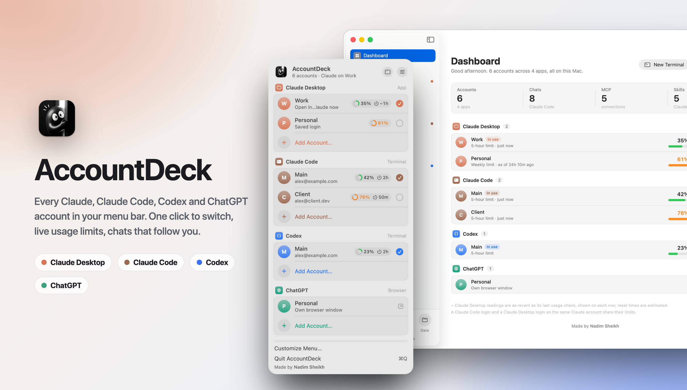
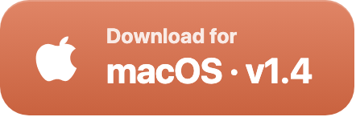
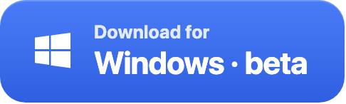
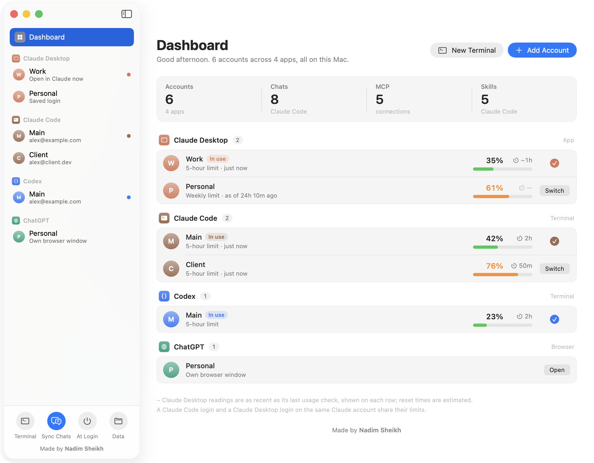
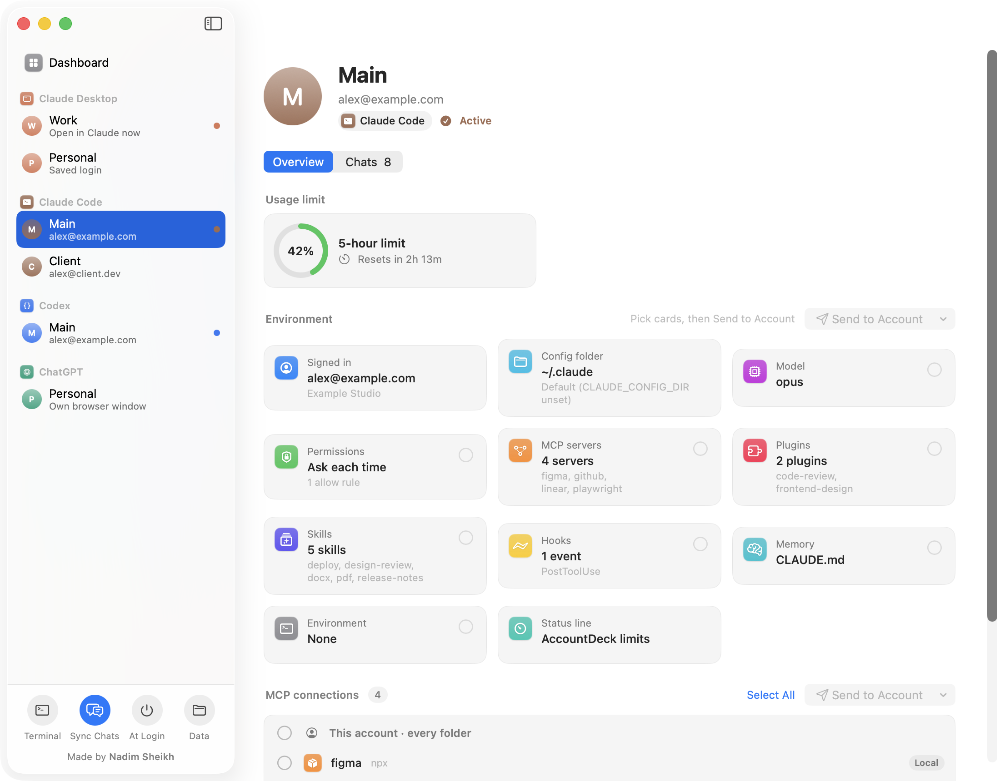
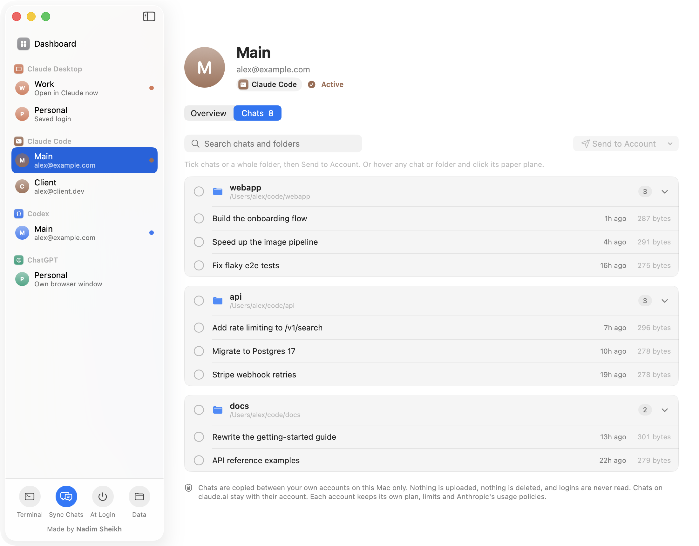
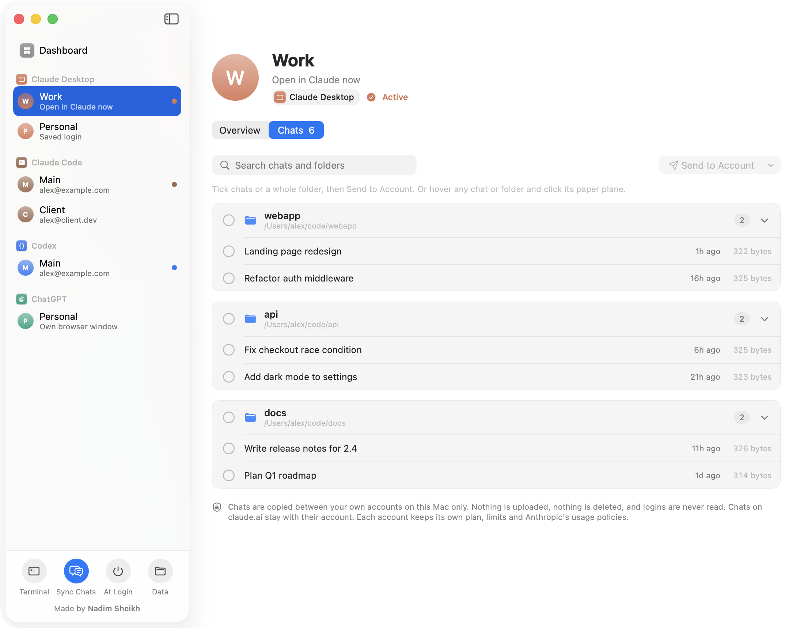
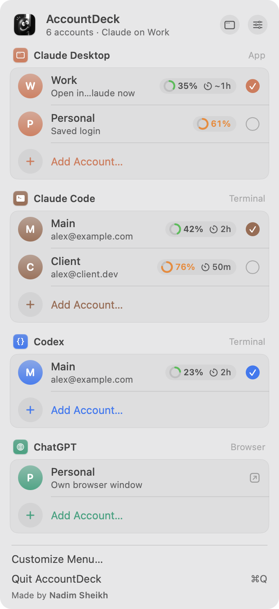

<picture>
  <source media="(prefers-color-scheme: dark)" srcset="docs/banner-dark.png">
  
</picture>

<p align="center">
  <a href="https://github.com/nadim-sheikh/AccountDeck/releases/latest/download/AccountDeck-1.5.2.dmg"></a>
  &nbsp;
  <a href="https://github.com/nadim-sheikh/AccountDeck/releases/latest/download/AccountDeck-Setup-1.0.0.exe"></a>
</p>

<p align="center">
  
  
  <a href="LICENSE"></a>
</p>

<p align="center">
  <b>Switch accounts in one click · See every usage limit live · Keep your chats when you switch</b><br>
  <sub>Free and open source. Everything stays on your computer.</sub>
</p>

---

## Download

Use the buttons at the top: they download the current stable version straight away. Older versions, the smaller Windows installers (Intel/AMD-only and Arm-only) and the release notes are on the [Releases page](https://github.com/nadim-sheikh/AccountDeck/releases/latest).

| | Needs | Status |
|---|---|---|
| **macOS** | macOS 14 or later, Apple silicon or Intel | Stable |
| **Windows** | Windows 10 or 11 | Beta, not yet tested on a real Windows PC |

## Install on a Mac

1. Open `AccountDeck-1.5.2.dmg` and drag **AccountDeck** onto **Applications**.
2. Open AccountDeck from Applications. macOS says it can't check the app for malicious software, because it isn't from the App Store or a registered Apple developer. Click **Done** (not *Move to Trash*).
3. Open **System Settings → Privacy & Security**, scroll down, and click **Open Anyway** next to AccountDeck. Confirm with your password or Touch ID.
4. AccountDeck opens, and its mascot appears in the menu bar. You only have to do this once.

Updating? Quit AccountDeck, drag the new version over the old one, and open it again. Your accounts stay where they are.

## Install on Windows (beta)

1. Download the installer and double-click it.
2. **Windows SmartScreen will warn you**, because the app isn't signed with a paid certificate. Click **More info**, then **Run anyway**.
3. AccountDeck opens its Dashboard and puts a small face icon in the tray next to the clock.

The Windows version was built and tested against a simulated Windows profile, but hasn't run on a real PC yet. See [windows/README.md](windows/README.md) for what still needs checking. Bug reports are very welcome.

---

## A look inside

<table>
  <tr>
    <td width="50%"><picture><source media="(prefers-color-scheme: dark)" srcset="docs/screenshots/dashboard-dark.png"></picture></td>
    <td width="50%"><picture><source media="(prefers-color-scheme: dark)" srcset="docs/screenshots/account-dark.png"></picture></td>
  </tr>
  <tr>
    <td><b>Dashboard.</b> Every account and its usage at a glance. Switch from here or from the menu bar.</td>
    <td><b>Account page.</b> Usage, sign-in, model, MCP servers, skills, plugins and hooks. Send any of them to another account.</td>
  </tr>
  <tr>
    <td><picture><source media="(prefers-color-scheme: dark)" srcset="docs/screenshots/chats-dark.png"></picture></td>
    <td><picture><source media="(prefers-color-scheme: dark)" srcset="docs/screenshots/desktop-dark.png"></picture></td>
  </tr>
  <tr>
    <td><b>Chats.</b> Your Claude Code chats grouped by project. Copy them to another account or resume one.</td>
    <td><b>Claude Desktop.</b> The Code-tab chats of each Claude Desktop account, kept in sync when you switch.</td>
  </tr>
</table>

<p align="center">
  <picture><source media="(prefers-color-scheme: dark)" srcset="docs/screenshots/menu-dark.png"></picture><br>
  <sub>The menu bar panel: every account, its limit and when it resets.</sub>
</p>

<sub>Screenshots use made-up demo accounts. You can make your own with <code>mac/snapshots/shoot.sh</code>.</sub>

## What it does

| App | How switching works |
|---|---|
| **Claude Desktop** | Closes Claude, saves the current login, puts the chosen account's login back and reopens Claude. Your Code-tab chats follow you to every account. |
| **Claude Code** | Each account gets its own config folder (`CLAUDE_CONFIG_DIR`). New terminal windows use the active account. |
| **Codex** | The same, with `CODEX_HOME`. |
| **ChatGPT** | Each account opens in its own browser profile, so you stay signed in to all of them. |

**Usage limits, live.** Each account shows how much of its 5-hour and weekly limit you've used and when it resets. AccountDeck watches the files these readings come from, so new numbers show up within about a second.
- Claude Code reports its limits with every reply, through a small status-line hook that AccountDeck can add for you. The hook prints nothing, and AccountDeck never replaces a status line you already have.
- Codex limits come from its session logs.
- Claude Desktop limits come from its own usage history. That history has no reset time, so the reset shown is an estimate (marked `~`).
- **Exact usage (macOS, optional).** Claude Desktop only saves its usage every few hours. If you allow it, AccountDeck asks Anthropic for your current usage with your Claude Code login, the same numbers as `/usage` in Claude Code, about once a minute. It shows them on that Claude account in both Claude Code and Claude Desktop. AccountDeck asks you once with a pop-up (Allow or Skip), and you can change it any time in **Customize Menu → Exact Usage**. For a Claude account you use only in Claude Desktop, click **Get exact usage** on its row and sign in once.

**Chats follow you (Claude Desktop).** Each time you switch accounts, the account you switch to gets your new chats from the other accounts, plus the latest version of every chat you changed. Chats you deleted elsewhere are removed there too. Before the first sync AccountDeck backs up all your chat lists, and it keeps a copy of anything it replaces or removes. You can turn this off with **Sync Chats**.

**Dashboard.** A window with every account in one place: usage bars, the signed-in email, MCP servers, skills and plugins, and the Claude Code chats for each account.

## What's new

See the [changelog](CHANGELOG.md).

## Privacy

- Everything stays on your computer. AccountDeck has no server, no analytics and no account of its own.
- It never shows or copies out your passwords or tokens. Claude Desktop's login files are only moved between Claude's own folder and AccountDeck's folder (`~/.accountdeck`).
- **Exact usage** is off until you allow it. When on, AccountDeck reads your Claude Code login from the macOS Keychain (macOS asks you first) and sends it only to Anthropic (`api.anthropic.com`), to ask for your usage and which account it belongs to. When that login has expired, AccountDeck renews it with Anthropic the way Claude Code does and saves it back to the same Keychain item, so Claude Code stays signed in. It first checks that it's allowed to save there, and doesn't renew if it isn't. The login is never written anywhere else or shown.
- Before AccountDeck first switches Claude Desktop, it keeps a backup of your original login.

## Build it yourself

**macOS** needs Xcode or the Command Line Tools (Swift 5.9+):

```bash
cd mac
./build.sh       # builds a universal AccountDeck.app and installs it in ~/Applications
./make-dmg.sh    # builds it and packs dist/AccountDeck-<version>.dmg
```

**Windows** needs Node.js 18 or newer, and builds from a Mac or a PC:

```bash
cd windows
npm install
npm test         # core logic against a fake Windows profile
npm run dist     # writes the installers to windows/dist/
```

## Repository layout

```
mac/         macOS app: SwiftUI, no dependencies (Sources/, Icon/, build.sh, make-dmg.sh)
windows/     Windows app: Electron (src/, test/, assets/, build/, package.json)
docs/        banner, screenshots (demo data) and the icon; docs/art/ renders the banner
mac/snapshots/  screenshot mode: runs the app on a demo home folder
```

## Contributing

Issues and pull requests are welcome. If something breaks while switching an account, please say which app, which platform, and what you saw.

## License

[MIT](LICENSE) © 2026 Nadim Sheikh. Made by [Nadim Sheikh](https://x.com/Nadim_404).

AccountDeck is an independent project. It isn't made by, endorsed by or affiliated with Anthropic or OpenAI. Claude, Claude Code, Codex and ChatGPT are trademarks of their owners.
